<!-- English version of README.md — keep both files in sync. -->

  <a href="README.md">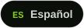</a>
  

<!-- ====================== HEADER ====================== -->

  

  <picture>
    <source media="(prefers-color-scheme: dark)" srcset="assets/tagline-en-dark.svg"/>
    
  </picture>

  
  &nbsp;
  <!-- Replace TU-USUARIO with your LinkedIn handle -->
  

 

<!-- ====================== 01 · ABOUT ====================== -->

  

 

<!-- ====================== 02 · EXPERIENCE ====================== -->

  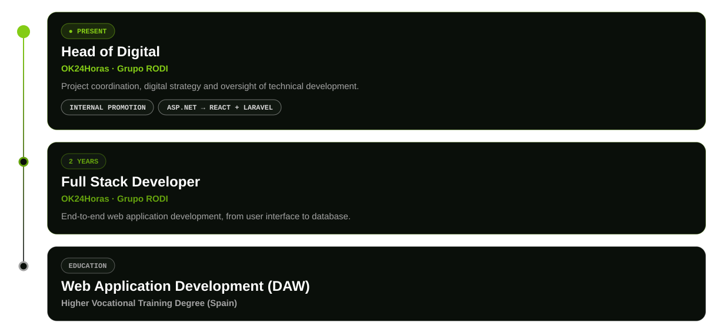

 

<!-- ====================== 03 · STACK ====================== -->

  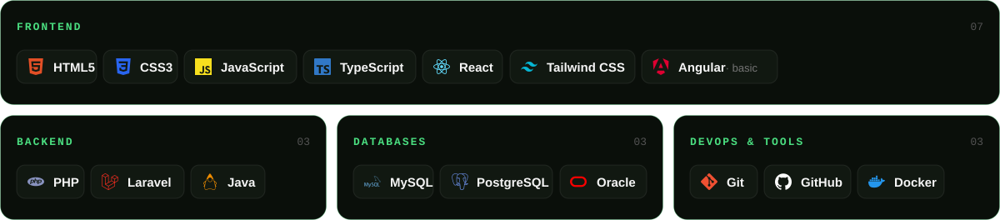

 

<!-- ====================== 04 · PROJECTS ====================== -->

  <a href="https://zensu.vercel.app">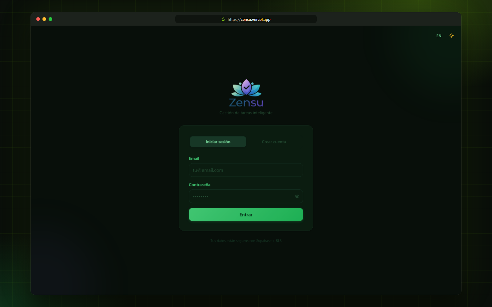</a>

  

  

 

  <a href="https://www.xixauxas.es">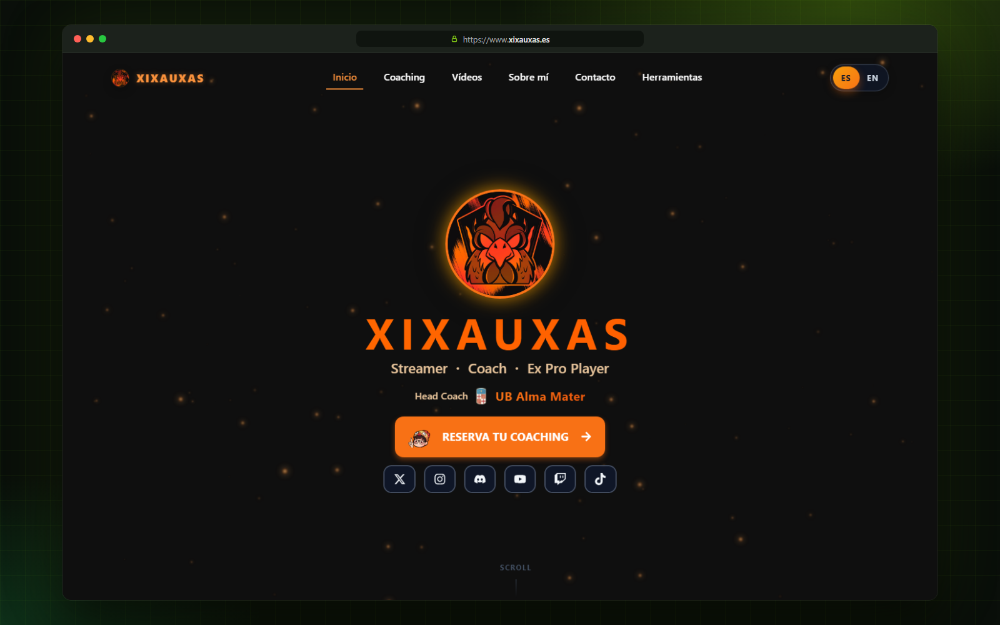</a>

  

  

 

<!-- ====================== 05 · LANGUAGES ====================== -->

  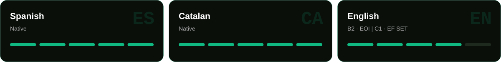

 

<!-- ====================== 06 · CERTIFICATIONS ====================== -->

  <a href="https://cert.efset.org/YjF4mA">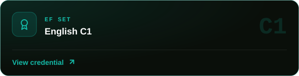</a>
  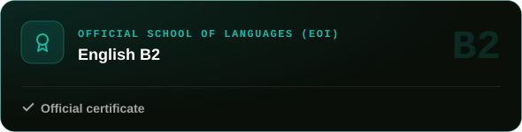

<b>Show more certifications (4)</b>

 

  <a href="https://skillshop.exceedlms.com/student/award/885R6WYRgqz8ZjDSTvqTJ22e">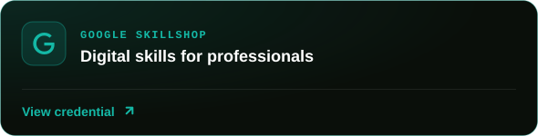</a>
  <a href="https://skillshop.exceedlms.com/student/award/466kx7XcQm9GaTJmx551tLEr">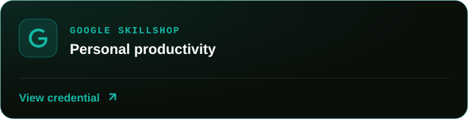</a>

  <a href="https://skillshop.exceedlms.com/student/award/JyNpgpNz1V2sxGqbp1dhiYys">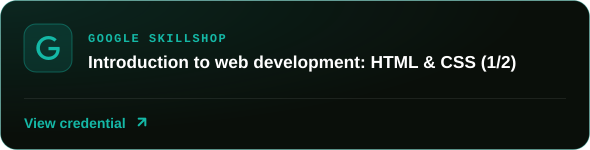</a>
  

 

<!-- ====================== 07 · ACTIVITY ====================== -->

  

<!-- ====================== FOOTER ====================== -->

  

