<!--
  Paleta por sección (degradado lima → verde azulado)
  ─────────────────────────────────────────
  Cabecera ............. #84cc16
  01 Sobre mí .......... #a3e635
  02 Trayectoria ....... #84cc16
  03 Stack ............. #4ade80
  04 Proyectos ......... #22c55e
  05 Idiomas ........... #10b981
  06 Certificaciones ... #14b8a6
  07 Actividad ......... #0d9488
  Pie .................. #0d9488 → #06b6d4 (cian, cierra el degradado)
  Fondo oscuro común ... #0a0f0a

  Los SVG de assets/ (cabecera, barras, trayectoria, stack, idiomas y pie) son propios.
  Los logos del stack son de Simple Icons (CC0) y están en scripts/icons/.
  Para regenerarlos tras cambiar textos o colores: python scripts/gen_svgs.py assets
  La tarjeta de "Actividad" la genera scripts/gen_activity.py vía .github/workflows/profile-assets.yml
  en la rama `output`.
-->

  
  

<!-- ====================== CABECERA ====================== -->

  

  <picture>
    <source media="(prefers-color-scheme: dark)" srcset="assets/tagline-es-dark.svg"/>
    
  </picture>

  
  &nbsp;
  <!-- Sustituye TU-USUARIO por tu perfil de LinkedIn -->
  

 

<!-- ====================== 01 · SOBRE MÍ ====================== -->

  

 

<!-- ====================== 02 · TRAYECTORIA ====================== -->

  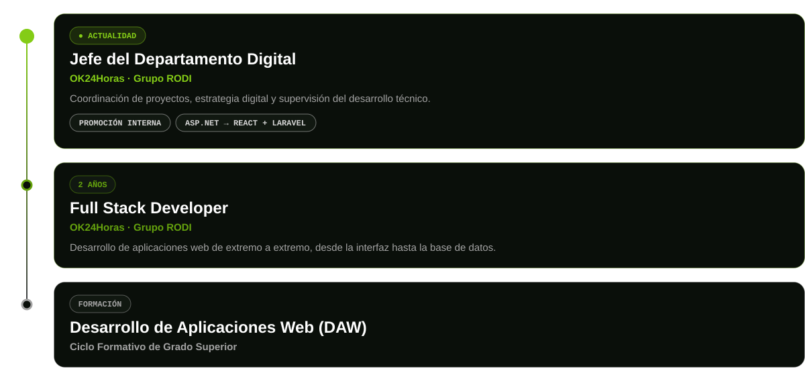

 

<!-- ====================== 03 · STACK ====================== -->

  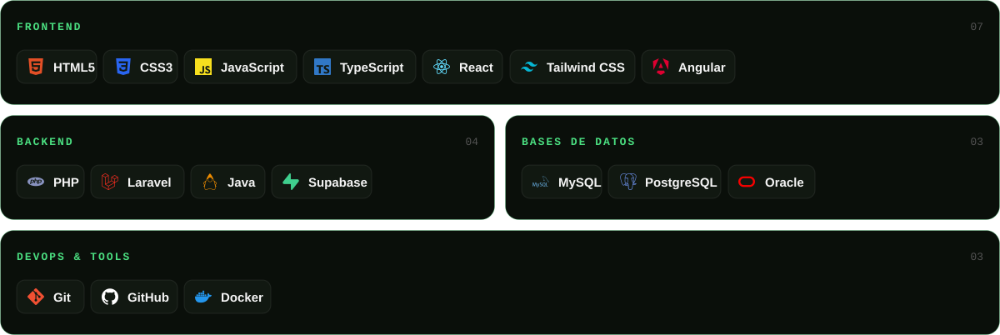

 

<!-- ====================== 04 · PROYECTOS ====================== -->

  

  

  

 

  

  

  

 

<!-- ====================== 05 · IDIOMAS ====================== -->

  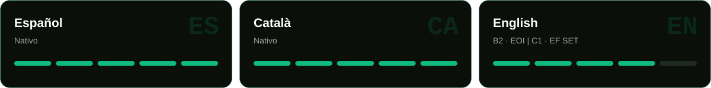

 

<!-- ====================== 06 · CERTIFICACIONES ====================== -->

  <a href="https://cert.efset.org/YjF4mA">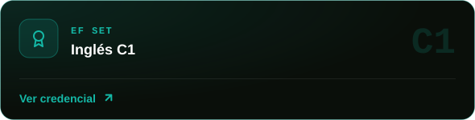</a>
  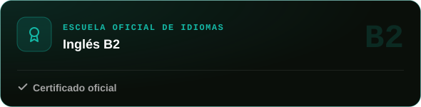

<b>Ver más certificaciones (4)</b>

 

  <a href="https://skillshop.exceedlms.com/student/award/885R6WYRgqz8ZjDSTvqTJ22e">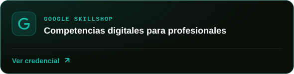</a>
  <a href="https://skillshop.exceedlms.com/student/award/466kx7XcQm9GaTJmx551tLEr">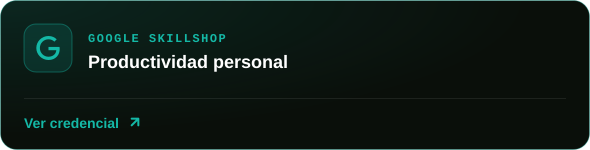</a>

  <a href="https://skillshop.exceedlms.com/student/award/JyNpgpNz1V2sxGqbp1dhiYys">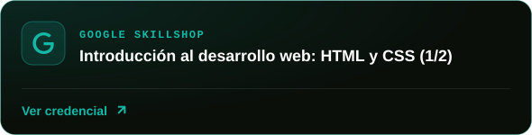</a>
  

 

<!-- ====================== 07 · ACTIVIDAD ====================== -->

  

<!-- ====================== PIE ====================== -->

  

